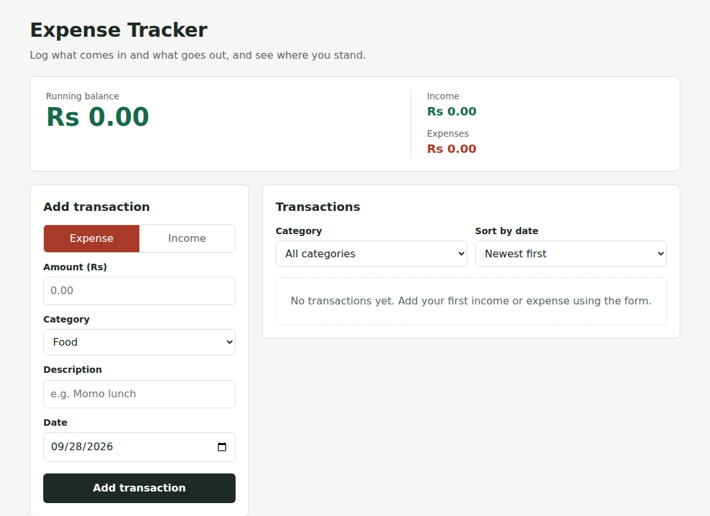
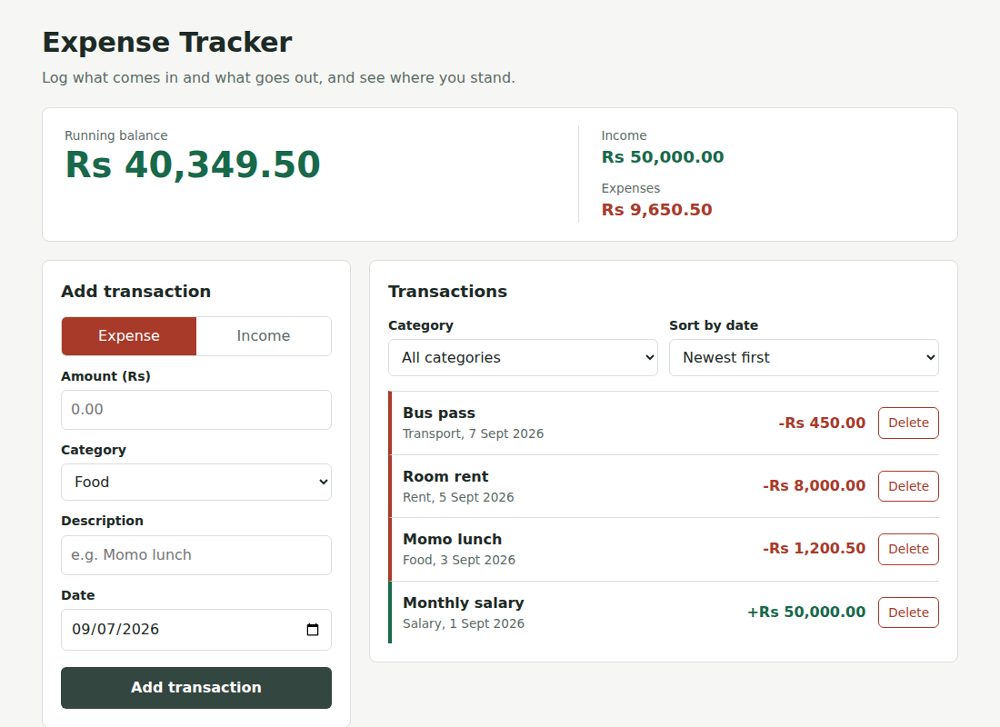
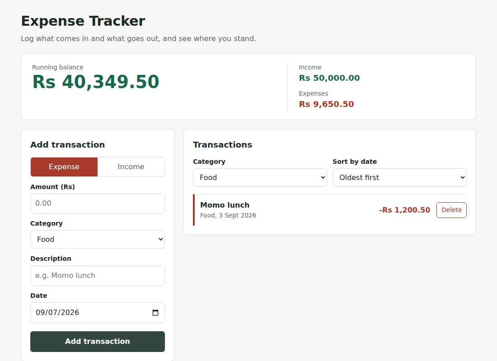

# Personal Expense Tracker

A single-page React app for logging income and expenses, viewing a running balance, and browsing transactions by category or date. All data is saved in the browser with localStorage, so it is still there after a refresh.

## Features

- Add a transaction with an amount, category, description and date, as either income or expense.
- Form validation with clear error messages (amount must be above zero, description and date required).
- Running balance (income minus expenses), plus separate income and expense totals.
- List of all transactions with a delete button on each entry.
- Filter by category and sort by date (newest or oldest first).
- Empty states for "no transactions yet" and "no matches for this filter".
- Data persisted with localStorage.
- Responsive layout for desktop and mobile widths.

## Technologies

- React 18 (functional components and hooks only)
- Vite 5
- Plain CSS

## Project Structure

```
src/
  components/   Header, BalanceSummary, TransactionForm, FilterBar,
                TransactionList, TransactionItem
  hooks/        useLocalStorage.js
  utils/        constants.js, helpers.js
  App.jsx
  main.jsx
  index.css
```

## Setup

1. Install Node.js 18 or newer.
2. Install dependencies: `npm install`
3. Start the dev server: `npm run dev` (or `npm start`)
4. Open the address shown in the terminal (usually http://localhost:5173).

To create a production build, run `npm run build`.

## Screenshots

Empty state:



Transactions and running balance:



Filtered by category and sorted oldest first:



## Known Limitations

- The optional stretch goals (spending chart, monthly summary, budget limit warning) are not implemented.
- Amounts are shown in Nepali rupees (Rs) only; there is no currency setting.
- Transactions cannot be edited after they are added, only deleted.
- Data lives in one browser on one device; clearing site data removes it.
